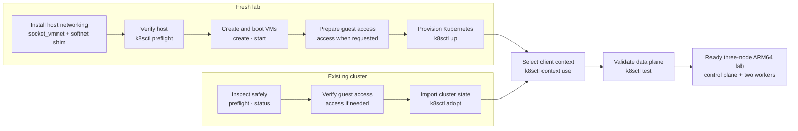

# Kubernetes on Tart + socket_vmnet (Apple Silicon)

Repeatable **3-node ARM64 kubeadm lab** for an Apple Silicon Mac. Install the `k8sctl` command from this checkout to adopt your existing lab or provision a new one.

> **Scope:** disposable personal labs only. This project is not a production Kubernetes distribution and deliberately supports a lab-only passwordless-sudo bootstrap path.

**YOUR EXISTING LAB COMES FIRST:** `adopt`, `status`, `doctor`, and `diagnose` are non-destructive. `up` creates missing VMs / joins missing nodes, but **will not reset an initialized control plane**. `reset-k8s` and `destroy` require an explicit typed confirmation flag. Nothing manages, reinstalls, deletes, or alters `/opt/tart-vmnet-shim/bin/softnet` or `socket_vmnet`.

## How it works



The diagram shows the user journey. See the [detailed architecture](docs/architecture.md) for component and network relationships, or follow the [documentation index](docs/README.md) to choose the right guide.

## Documentation guide

| What you need                                | Start here                                                                  | Continue with                                                  |
| -------------------------------------------- | --------------------------------------------------------------------------- | -------------------------------------------------------------- |
| Install everything on a new Mac              | [Softnet and socket_vmnet setup](docs/shim-setup.md)                        | [Fresh cluster provisioning](#full-fresh-cluster-provisioning) |
| Adopt an already-running cluster             | [Existing-cluster workflow](#first-use-with-your-currently-working-cluster) | [Operations runbook](docs/runbook.md)                          |
| Understand the implementation                | [Architecture](docs/architecture.md)                                        | [Networking](docs/networking.md)                               |
| Stabilize addresses or diagnose connectivity | [Networking](docs/networking.md)                                            | [Operations runbook](docs/runbook.md)                          |
| Operate, test, recover, or rebuild           | [Operations runbook](docs/runbook.md)                                       | [Project roadmap](docs/project-plan.md)                        |
| Contribute or report a vulnerability         | [Contributing](CONTRIBUTING.md)                                             | [Security policy](SECURITY.md)                                 |
| Prepare and publish a release                | [Release checklist](docs/releasing.md)                                      | [GitHub settings](docs/github-settings.md)                     |

The complete topic map is available in the [documentation index](docs/README.md).

## Folder structure

```text
k8s_tart/
├── k8sctl.py                       # Main Mac automation CLI
├── config/cluster.toml             # All cluster/VM/shim parameters
├── scripts/guest/prepare-node.sh   # Idempotent uninitialized-Ubuntu preparation
├── scripts/host/install-cli.sh     # Guarded user-local CLI install/uninstall
├── docs/
│   ├── README.md                   # Documentation index and reading paths
│   ├── architecture.md             # Stack and flows
│   ├── networking.md               # Shim, daemon and DHCP/IP drift runbook
│   ├── runbook.md                  # Rebuild, repair and troubleshooting
│   ├── shim-setup.md               # From-scratch socket_vmnet and shim setup
│   └── project-plan.md             # Work backlog and acceptance criteria
├── tests/test_lab.py               # Offline safety/config unit tests
├── .github/                       # Issue and pull-request templates
├── SECURITY.md                     # Private vulnerability reporting and boundaries
├── CONTRIBUTING.md                 # Contributor workflow and safety requirements
├── LICENSE                         # Apache License 2.0
├── vendor/README.md                # Pinned Flannel manifest cached on use
├── Makefile                        # Optional short commands
├── .gitignore                      # Kubeconfigs, state, reports, logs excluded
├── .state/                         # Automatically created: recorded IPs, kubeconfig
├── logs/                           # Automatically created: background Tart logs
└── reports/                        # Automatically created: diagnostic snapshots
```

If you are starting from scratch, complete the [Softnet shim and socket_vmnet setup](docs/shim-setup.md) before creating any VMs. It covers the daemon, compatibility shim, exact `cluster.toml` values, preflight output, and security implications. If a working installation already exists, preserve it and verify its paths rather than replacing it.

## Host prerequisites

- Apple Silicon Mac with Tart installed, all VMs Ubuntu ARM64.
- Python **3.11+** (`python3 --version`, or `brew install python`). No PyPI packages.
- `kubectl` on the Mac (`brew install kubectl`) for API management and smoke tests.
- Functional `socket_vmnet` daemon and compatible `softnet` shim, follow the [from-scratch setup](docs/shim-setup.md) when they are not already installed.
- OpenSSH client and SSH keys for the Ubuntu `admin` account.
- For fully unattended guest provisioning, `admin` must have passwordless sudo **on lab VMs only**. The interactive `access` helper can set this up.
- VM networking reachable at `192.168.105.0/24` by default, edit config if not.
- Sufficient memory/storage: 2 vCPU/6 GiB CP, 2 vCPU/4 GiB per worker.

Remote inputs are immutable by default: the Ubuntu OCI image is pinned by digest, and both the Flannel manifest and Kubernetes repository key are verified against SHA-256 values in `config/cluster.toml`. Treat changes to these values as supply-chain updates requiring review and a fresh disposable cluster test.

## Install the CLI command

Python 3.11 or newer must already be installed. No PyPI packages are needed.

```bash
cd ~/myprojects/k8s_tart
python3 --version
make install-cli
```

This installs `~/.local/bin/k8sctl` plus every additional command configured by `cluster.cli_aliases` in `config/cluster.toml`. These are real executable symlinks—not shell aliases—so they work in interactive shells and scripts:

```toml
[cluster]
cli_aliases = ["ttk"]              # Add more names here if desired
```

Rerun `make install-cli` after changing the list. The checkout remains the source of configuration, state, logs, and reports. If `~/.local/bin` is not already on `PATH`, the installer prints the exact line to add. It refuses to overwrite unrelated commands.

```bash
k8sctl --version
ttk --version
k8sctl --help
k8sctl preflight
```

The checkout must remain at its installed location. `make uninstall-cli` removes the primary command and all currently configured additional names. You can override the installation directory for either operation with `K8SCTL_BIN_DIR=/another/bin`.

## Guided command chaining

Every successful provisioning command ends with `NEXT:` (and sometimes `THEN:`), explaining what to run and why. When a command invokes another provisioning stage internally, intermediate advice is suppressed so only the next user action is shown.

| Completed command                            | Next command                                 | Why it is needed                                                        |
| -------------------------------------------- | -------------------------------------------- | ----------------------------------------------------------------------- |
| `preflight`                                  | `create` for fresh, or `status` for existing | Confirm host networking first, then choose the correct lifecycle path   |
| `create`                                     | `start`                                      | Cloned VM disks must be booted before IP or SSH checks                  |
| `start` on stock/fresh VMs                   | `access`                                     | `up` requires SSH-key login and passwordless sudo on every guest        |
| `start` with access ready, no lab kubeconfig | `up`                                         | Guests are ready for unattended Kubernetes provisioning                 |
| `start` on a previously provisioned lab      | `status`, then optionally `test`             | Verify IP stability and cluster health after restart                    |
| `access` with no control plane               | `up`                                         | Install packages, initialize kubeadm, install Flannel, and join workers |
| `access` with an existing control plane      | `adopt`                                      | Import existing credentials/state without rebuilding Kubernetes         |
| `adopt`                                      | `context use`                                | Make the isolated lab credentials visible to normal `kubectl`           |
| `up`                                         | `context use`, then `test`                   | Refresh/select the client context, then validate the data plane         |
| `context use`                                | `test`                                       | Verify cross-node Pods, DNS, and ClusterIP routing                      |
| `test`                                       | `status`                                     | Confirm the cluster remains healthy after temporary test cleanup        |
| `stop`                                       | `start`                                      | Boot the retained VM disks when the lab is needed again                 |
| `reset-k8s`                                  | `up`                                         | Reinitialize Kubernetes on the retained VMs                             |
| `destroy`                                    | `create`                                     | Begin a completely fresh VM and cluster lifecycle                       |

For stock Ubuntu images, `access` is an intentional interactive prerequisite. It can be skipped only when the configured base image already contains the SSH public key and lab-only passwordless sudo policy.

## First use with your _currently working_ cluster

```bash
cd ~/myprojects/k8s_tart
python3 --version
k8sctl preflight
k8sctl status

# If SSH public keys or passwordless sudo are not configured on the VMs:
k8sctl access  # INTERACTIVE, changes guest authorized_keys + sudoers

# Read-only Kubernetes adoption (downloads existing admin.conf, saves IP state):
k8sctl adopt

# Add the lab to normal kubectl contexts and switch to it:
k8sctl context use
kubectl config get-contexts
kubectl get nodes -o wide

# No rebuild: inspect and run temporary cluster smoke tests
k8sctl doctor
k8sctl test
k8sctl diagnose
```

**Adoption needs SSH and sudo permissions.** The `access` step is _not_ read-only: it appends an SSH public key and installs a permissive `admin` sudoers entry on the three lab VMs. Use only on your isolated personal lab. You can do equivalent SSH/sudo setup manually and skip `access`.

`adopt` validates `admin.conf`'s API endpoint against the control-plane IP, fetches the config securely to `.state/kubeconfig`, and records node IPs into `.state/node_ips.json`. It **does not run kubeadm init/reset**.

`context use` merges namespaced cluster, user, and context entries named `tart-kubeadm-lab` into the first path in `KUBECONFIG`, or `~/.kube/config` when that variable is unset. It preserves all existing contexts, creates a timestamped backup, and then selects the lab. Useful commands are:

```bash
k8sctl context status                  # Is the context registered?
k8sctl context install                 # Register without switching
k8sctl context use                     # Register/update and switch
kubectl config use-context orbstack     # Switch to another existing context
k8sctl context remove                  # Remove only k8sctl-managed entries
```

Use `--name` to choose another context name and `--target` to select a specific client kubeconfig. The isolated `.state/kubeconfig` remains the automation source and is never used as the merge target.

## Full fresh cluster provisioning

First-time users must install and validate the host networking layer before creating VMs:

```bash
# Follow this document through a successful read-only preflight:
open docs/shim-setup.md
k8sctl preflight
```

Then configure and provision the cluster:

```bash
# Set your image, VM resources, Kubernetes minor version, socket path, etc.
vi config/cluster.toml

# For machine-specific experiments without modifying the tracked defaults:
cp config/cluster.toml config/cluster.local.toml
k8sctl --config config/cluster.local.toml preflight

# Required for stock images, skip only when SSH key + passwordless sudo are preconfigured
k8sctl create
k8sctl start
k8sctl access

# Full automation (safe on already-initialized nodes and not a cluster upgrader)
k8sctl up
k8sctl context use
k8sctl test
```

After `start`, the CLI probes every VM and explicitly reports whether interactive `access` is required. `up` is designed to be re-runnable and checks for existing kubeadm files and it never forces a control-plane reinit. For **completely hands-off provisioning from scratch**, preconfigure SSH key access and passwordless sudo in a reusable Ubuntu base image, or run the `access` command once after creating new VMs. Standard upstream Ubuntu images require a first-login bootstrap.

Provision steps: `preflight -> clone missing VMs -> tart run --net-softnet -> agent IP + drift guard -> SSH/guest TCP checks -> Linux/containerd/K8s prep -> kubeadm init if missing -> Flannel if missing -> worker joins if missing -> wait for node Ready -> context use -> smoke test`.

### Command reference

| Command                                      | Effect                                                   | Destructive?                    |
| -------------------------------------------- | -------------------------------------------------------- | ------------------------------- |
| `preflight`                                  | Tart/shim/socket/dependency checks                       | No                              |
| `access`                                     | Add SSH key and guest passwordless sudo                  | Changes guest access            |
| `adopt`                                      | Register existing healthy cluster, copy kubeconfig       | No change to VMs/K8s            |
| `context use`                                | Safely install/update and select the lab kubectl context | Changes client kubeconfig only  |
| `context install`                            | Install/update context without selecting it              | Changes client kubeconfig only  |
| `context remove`                             | Remove managed context and restore prior selection       | Changes client kubeconfig only  |
| `create`                                     | Clone and size only missing VMs                          | Creates VMs                     |
| `start`                                      | Start stopped VMs with shim and IP drift check           | No reset                        |
| `ssh NODE`                                   | Open a terminal on a configured running node             | No                              |
| `up`                                         | Reconcile new/missing Kubernetes components              | Changes missing components      |
| `status`                                     | VM IP/state, Kubernetes nodes and nonrunning Pods        | No                              |
| `doctor`                                     | Read-only host, guest and Kubernetes health checks       | No                              |
| `diagnose`                                   | Save detailed read-only logs under reports/              | No                              |
| `test`                                       | Temporary BusyBox/NGINX namespace and delete on exit     | Transient test resources        |
| `monitor --interval 30`                      | Continuous health polling                                | No                              |
| `stop`                                       | Stop 3 VMs, retain disks/data                            | Stops compute                   |
| `reset-k8s --yes --confirm tart-kubeadm-lab` | Reset kubeadm/CNI on all guests                          | **YES: destroys cluster state** |
| `destroy --yes --confirm tart-kubeadm-lab`   | Stop and delete the 3 Tart VMs                           | **YES: destroys VM disks**      |

Convenience: `make status`, `make doctor`, `make up`, `make monitor`, and `make test`. Destructive Make targets still require explicit flags, so prefer the direct CLI.

## Softnet shim installation and recovery

The [shim setup guide](docs/shim-setup.md) covers new installation, daemon configuration, preflight interpretation, and recovery. The project includes `scripts/host/network-inventory.sh` to capture the current state and a **manual-only**, guarded `scripts/host/restore-softnet-shim.sh` build/install helper. Neither is invoked by `up` or `start`.

## Day-2 lifecycle

```bash
k8sctl status
k8sctl ssh k8s-cp
k8sctl ssh k8s-w1 --command 'hostname && uptime'
k8sctl monitor --interval 30 --count 10
k8sctl diagnose
k8sctl stop
k8sctl start
k8sctl status
```

Stopping and starting the VM **does not guarantee** the same DHCP IP. We record the initial mapping and abort operations if a restarted VM's IP drifts. Set up MAC-based DHCP reservations **for the currently working addresses** if you wish to keep this cluster for long-term repeated starts. See [docs/networking.md](docs/networking.md).

## What the smoke test covers

1. Runs BusyBox Pods pinned to each worker, it verifies both are `Ready`.
2. Pings from one worker's Pod to the other worker's Pod (Flannel VXLAN).
3. Resolves Kubernetes service DNS from inside a Pod (CoreDNS).
4. Deploys NGINX and requests it through a ClusterIP Service (kube-proxy).
5. Removes the temporary namespace by default (`--keep` retains it).

The smoke test changes temporary resources, not your existing applications. It requires all nodes healthy and outbound image registry access.

## Safe removal

To delete Kubernetes while **keeping Ubuntu VMs and shim**:

```bash
k8sctl reset-k8s --yes --confirm tart-kubeadm-lab
```

To delete **only the 3 named Tart VMs**, leaving the existing shim, daemon, other Tart VMs, cached images, project source and logs untouched:

```bash
k8sctl destroy --yes --confirm tart-kubeadm-lab
```

`reset-k8s` does not remove Ubuntu packages, containerd or persistent data outside kubeadm's standard state and CNI paths. It is **not** a complete sanitization procedure. `destroy` removes the three named VM disks. Neither command uninstalls Tart, removes the shim or stops `socket_vmnet`.

## Tests and development

```bash
make validate
shellcheck scripts/guest/prepare-node.sh scripts/host/*.sh
```

The local unit tests do not need an Apple Mac or a running Kubernetes cluster. The smoke test **does** operate on a live Kubernetes cluster.

## Known constraints

- This is a **single-control-plane lab** with no etcd HA or node redundancy.
- `up` is **not** a Kubernetes upgrade or disaster-recovery engine.
- IP drift is reported, **not** automatically repaired. Repairing kubeadm endpoint/certificates/etcd membership can be destructive, see networking doc.
- The shim does not enforce normal Softnet allow/block packet filtering. Treat these VMs as being on a shared L2 network and don't expose sensitive services.
- `SOCKET_VMNET_PATH` is passed only to Tart child processes, not changed globally in your login shell.
- The first machine-image provisioning needs network access for Ubuntu APT, Kubernetes packages, container images and the pinned Flannel manifest.
- Maintainers must validate provisioning, smoke tests, restart, and teardown on a disposable Apple Silicon lab before releasing.

See [runbook](docs/runbook.md), [networking](docs/networking.md), and [project roadmap](docs/project-plan.md). Maintainers should also follow the [release checklist](docs/releasing.md) and apply the recommended [GitHub repository settings](docs/github-settings.md).

## Security and contributing

Read [SECURITY.md](SECURITY.md) before reporting vulnerabilities or sharing diagnostic bundles. Contributions should follow [CONTRIBUTING.md](CONTRIBUTING.md) and preserve fail-closed behavior around initialized clusters, credentials, CNI changes, and destructive operations.

## License

Licensed under the [Apache License 2.0](LICENSE).
