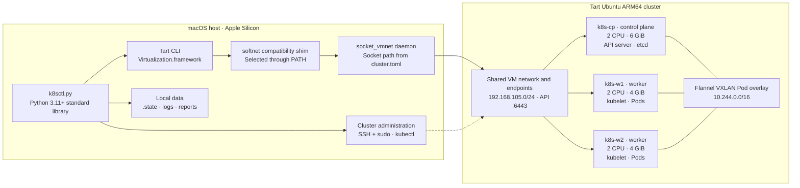

# Architecture and implementation

[Documentation index](README.md) · [Project README](../README.md)

Solid arrows show lifecycle or network attachment. The dotted arrow shows the
SSH and Kubernetes administration path. Undirected connections show that all
nodes participate in the same Flannel Pod overlay.

## Layers

- **Tart**: Apple Virtualization.framework ARM64 Ubuntu VMs, running headless.
- **Shim**: compatibility binary that translates Tart datagrams to the framed
  stream protocol used by `socket_vmnet`.
- **socket_vmnet**: root daemon that owns the macOS virtual network and exposes
  the Unix socket configured in `cluster.toml`.
- **VM NICs**: 192.168.105.0/24 (check the live guest-agent IP, DHCP
  reservations are urged).
- **containerd**: CRI, systemd cgroups, runs Kubernetes and user containers.
- **kubeadm**: creates control-plane PKI, static Pods, and kubelet bootstrap
  configuration.
- **Flannel**: pinned release manifest, Pod CIDR 10.244.0.0/16, VXLAN over the
  VM L2 network.
- **Kubernetes Service**: default service CIDR 10.96.0.0/12.
- **Client**: `.state/kubeconfig` remains isolated automation state, `k8sctl
context` can safely merge a namespaced entry into the normal client
  kubeconfig, with a backup and collision protection.

## Configuration

Config is TOML (Python 3.11 `tomllib`) to avoid Helm/Ansible/YAML parser
requirements for host automation. `k8sctl.py` imports only the standard library.

## Idempotence boundaries

- Existing VMs are neither resized nor recloned.
- Existing initialized kubeadm nodes skip preparation/init.
- Existing Flannel DaemonSet skips installation rather than doing an upgrade.
- Existing joined workers skip token creation/join.
- IP address drift is fatal and automatically updating kubeadm PKI is forbidden.
- Destructive operations require explicit cluster-name confirmation.

**ARM64 matters:** all container images/add-ons must support `linux/arm64`.
No NVIDIA GPU is provided by this Apple Silicon VM stack.

## Related documentation

- [Softnet shim setup](shim-setup.md) installs the host network components.
- [Networking](networking.md) explains DHCP, Flannel, and IP-drift handling.
- [Operations runbook](runbook.md) covers testing and recovery procedures.
